  

  

  
  
  
  
  
  
  
  
  
  
  

---

## 🚀 航行日志 / MISSION LOG

我相信服务应该握在自己手里：能自托管的就不假手于人，能开源的就
整理出来分享。主航道是 **Cloudflare 全家桶**（Workers + R2 + D1），
配一台自己的服务器做压舱石，上面跑着文件库、短链、邮件与数据服务。

- 🛰️ **Cloudflare-first**：边缘计算 + 对象存储 + 边缘数据库，能跑在
  免费额度里的绝不花冤枉钱
- 🔐 **自托管优先**：自己的数据自己管，账号、权限、配置进真正的
  数据库，不塞进对象存储里当 JSON
- 🛠️ **折腾到底**：一个问题定位到根因才算完，证伪过的轮次不重复，
  交付前一定在真实环境跑通

## 🪐 核心星域 / FEATURED AREAS

| 星域 | 在造什么 | 技术栈 |
| --- | --- | --- |
| 🗂️ **自托管文件库** | 文件浏览、文件夹级权限、提取码分享、短链、音视频播放、WebDAV | Workers · R2 · D1 · Vue |
| 🔗 **短链服务** | 短链生成与管理，后台一键总开关，关掉就全站隐藏 | Workers · D1 · KV |
| ✉️ **邮件系统** | 自托管邮件收发，域名邮箱统一汇聚 | Workers · D1 · R2 |
| 📡 **链上数据雷达** | 链上交易事件流与异动提醒 | Workers · WebSocket · SQLite |

> 部分项目正在整理开源中，陆续公开。先上线的会第一时间出现在这里。

## 📊 航行数据 / GITHUB STATS

  
  

  

  <b>探索不止，折腾不息 — To the stars, and beyond. ✦</b> 
  🌐 <a href="https://www.nesive.com">nesive.com</a>

